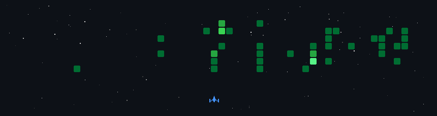

<h1 align="center">Hi, I'm Aneesh Mokashi 👋</h1>

<p align="center">
  <b>Software Engineer • AI/ML Engineer • Backend & Distributed Systems</b>
</p>

<p align="center">
  <a href="https://linkedin.com/in/aneeshkmokashi/"></a>
  <a href="https://aneeshkm.github.io/"></a>
  <a href="mailto:aneeshkmokashi@gmail.com"></a>
</p>

---

### About Me

I'm a **Computer Engineering graduate from NYU** with experience building scalable backend systems, distributed applications, and AI/ML pipelines.

- Previously worked at **Accenture**, developing Java/Spring Boot microservices, Kafka-based banking systems, and full-stack applications using React, TypeScript, and AWS.
- Worked as a **Research Assistant at NYU Langone Health**, fine-tuning vision-language models on 50K+ clinical images and developing LLM-based clinical data workflows using LangGraph, FastAPI, and MCP.
- Built **RAG applications, MLOps pipelines, model evaluation systems, and real-time data processing applications**.
- Interested in **AI systems, backend engineering, distributed systems, MLOps, and cloud-native applications**.

---


## Technical Skills

**AI / ML & LLM Systems**

<p>
        
</p>

**Backend & Full-Stack Development**

<p>
        
</p>

**Databases & Data Systems**

<p>
         
</p>

**Cloud, DevOps & Infrastructure**

<p>
        
</p>

**Languages**

<p>
       
</p>

---

### Featured Projects

- **[CiteCraft - Source-Grounded PDF Research Assistant](https://github.com/aneeshKM/CiteCraft-RAG)**  
  Built a RAG assistant for querying multiple PDFs with filename and page-level citations using parent-summary retrieval, PostgreSQL/pgvector, and Redis. Achieved **85.9% source-grounded responses** and **90% abstention accuracy** on a 32-question evaluation.  
  `Python` `OpenAI` `PostgreSQL` `pgvector` `Redis` `Streamlit`

- **[Jitsi Topic Segmentation & Recap MLOps System](https://github.com/aneeshKM/ML-Sys-Ops-Project)**  
  Built transcript ingestion and data orchestration workflows with PostgreSQL-backed state, human-feedback capture, retraining datasets, and production model monitoring.  
  `Python` `PostgreSQL` `Docker` `MLflow` `Grafana`

- **[Optimizing Transformer-Based Time Series Forecasting](https://github.com/aneeshKM/Optimizing-Temporal-Fusion-Transformer)**  
  Optimized Temporal Fusion Transformer using FlashAttention, quantization, and Optuna tuning, achieving **10.9% faster training**, **42.4% faster inference on A100**, and **74.7% smaller model size**.  
  `PyTorch` `FlashAttention` `Optuna` `Quantization`


<p align="center">
  <a href="https://aneeshkm.github.io/#projects"><b>Explore More Projects →</b></a>
</p>

---

### Currently Interested In

```txt
AI Systems • MLOps • Backend Architecture • LLM Applications • Distributed Systems
```

<p align="center">
  
</p>
